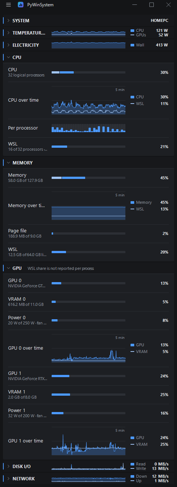

## Features

* CPU, per-processor load, memory, page file, GPU and VRAM, disk I/O and network, refreshed every 1, 2 or 5 seconds.
* Time graphs over the last 300 samples for CPU, memory, each GPU with its VRAM, physical disk I/O and network. A folded panel keeps a small graph in its header, and System folds to the host name.
* Processes page: every process with its CPU and private memory, read in one system call (about 5 ms for 500 processes), sorted by name, CPU or memory. Filter by a name, PID or path in the search box, by kind (Apps own a window, or descend from one under the same name; Windows run from the Windows folder; Background is the rest) and by use (CPU 1% or more, memory 100 MB or 1 GB or more); the kind, use and sort are remembered. A List or Tree view; the tree folds a branch and keeps a filtered match under its ancestors. Each row says what a host process runs: the script of python, node and wsl, the services in svchost from the service manager (no administrator rights needed), the COM name of dllhost, and for conhost the console program that started it. A row opens to show the path, command line, working folder, user, parent, start time, threads, handles, memory and I/O, with Open location, Copy path and Copy command line. Command lines of elevated and system processes need Run as administrator. Processes are read only while the page is open. Linux processes of every running WSL distro show under vmmemWSL (a WSL kind, with user, state and command line), read by one small helper per distro that runs only while the page is open; a stopped WSL is never started for this. With more than one distro running, the WSL kind adds a chip per distro. A tree branch folds under any filter.
* What WSL takes of each: its CPU and memory against the `.wslconfig` limits, the memory its VM holds on Windows, and its disk and network traffic.
* MAC, private IP, gateway and DNS of each adapter; the public IP is asked from cloudflare.com only when you press Look up. A label or description cut short shows in full in a tip. Click an address, a MAC or the host name to copy it.
* Hardware page: processor, mainboard, each memory module with its channel, part number and speed, and each display adapter with VRAM, PCIe link and driver. The memory panel says how many channels the modules fill (dual, quad and so on, read from the slot names), the speed they run at against their rating, and the peak bandwidth that makes (MT/s × 8 bytes × channels).
* Processor details on the Hardware page without administrator rights: performance and efficiency cores apart on a hybrid chip, the L1 and L2 cache of each kind of core and the shared L3, the stepping and microcode revision, the instruction sets Windows can use (SSE4.1 up to AVX-512), and the clock now with the lowest and highest seen since the app started. The rated turbo clock is not shown, as the processor does not tell it while Hyper-V runs underneath Windows, as it does with WSL 2.
* Benchmarks buttons open the processor on PassMark, Technical City and UserBenchmark, and each graphics card on Technical City and UserBenchmark, in your browser; the app itself sends nothing. UserBenchmark may first ask you to pick the human once.
* Monitors page, one panel per display, left to right: brightness, contrast, colour gains, volume and the input source over DDC/CI where the monitor answers it, only what its capabilities list; brightness, contrast, colour temperature and red, green and blue of the graphics card gamma for any monitor; full-screen test patterns; and what the EDID says (vendor, product code, serial, date of manufacture, size), the graphics card, the port and its sockets. The monitors are read the first time the page opens, as DDC/CI answers slowly. Changed gamma comes back after sign-in, unlock and resume through a task of your own account, PyWinSystem Monitors in Task Scheduler, with or without the app running; the task goes when every display is back to untouched. Kept after a restart at the top of the gamma settings tells whether that task is in place. Reset every monitor is in Settings.
* Under each graphics card on the Hardware page its sockets in driver order, filled where a display is plugged in, with a tip naming the display. A monitor that can daisy-chain has a DisplayPort MST hub inside and still lands on its own socket; only a chained display whose socket the driver does not tell gets a socket of its own after the real ones.
* WSL page: the distribution and whether it runs, the networking mode, the ports published, opened, forwarded and listening inside WSL, and what is not applied yet. It reads without starting a stopped WSL. Restart WSL needs no administrator rights in mirrored mode.
* WSL service: publishes chosen ports of WSL to the LAN (Hyper-V and Windows firewalls in mirrored mode, port forwarding in NAT mode), starts WSL and your startup commands on boot without a logon, keeps the distribution running, and recovers it after sleep by a restart or by repairing only what broke. Apply registers the tasks; they run without the app. The same works from the command line, see below.
* Edits `%USERPROFILE%\.wslconfig` and `/etc/wsl.conf` of the distribution in place, keeping comments; the first change keeps the old file as `.bak`, and a value equal to the WSL default is removed rather than written. A default user that does not exist or a malformed host name is refused before it is written.
* Disk list with media, bus, size and the health Windows reports, Storage Spaces drives included.
* Disk health: NVMe temperature, life used, spare, power-on time, data written and read, unsafe shutdowns and media errors without administrator rights; SATA SMART attributes after Run as administrator. A hard disk that is asleep is left asleep unless you press Read anyway.
* GPU power against its limit, fan, core and memory clocks, and system uptime.
* Windows edition, version and build (for example Windows 11 Pro · 26H2 · build 26300.9818) beside the host name.
* Temperature and power panel: CPU package power from the Windows energy counter (Intel RAPL), GPU temperature and power, NVMe temperatures, a power graph, and CPU and mainboard temperatures and fans while LibreHardwareMonitor runs.
* Electricity cost: wall power from the measured CPU and GPUs, NVMe drives from their own power state table (top state while busy, lowest while idle), hard disks by whether they spin, monitors by count and whether Windows has the displays on, and a setting for the rest; the case goes through the power supply efficiency, the monitors do not. It graphs the wall power, shows the cost per hour, day and month at the current draw, and what today and this month cost while the app ran. Plans for Korea (progressive home tiers with summer steps, or one flat price), the United States and Japan; every price lives in %APPDATA%\PyWinSystem\tariffs.json and an edit applies at once. Stepped prices count the PC on top of the rest of the home.
* BIOS vendor, version and date, firmware type and Secure Boot state on the Hardware page.
* Network adapters on the Hardware page, a tray icon with Close to tray, and Auto hide menu, which shows the header only while the cursor is over the window.
* Only performance counters are sampled, so an idle hard disk is not woken; the disk list is read at start and on request.
* Auto, dark and light themes.

## Screenshot

## How to install

* Just download and install the latest release.
* Alternatively, if you like to build your own, download or clone a repository then execute makebuild.py. Python 3.x, Python packages in the requirements.pip file, PyInstaller and Inno Setup are required.
* To run from the source, install Python packages in the requirements.pip file, then execute source/main.pyw with pythonw.exe.
* GPU figures need an NVIDIA driver (NVML).
* Execute source/makeshortcut.py to put a shortcut in the Start menu.

## WSL from the command line

`PyWinSystem.exe --wsl ACTION`, or `pythonw.exe source/main.pyw --wsl ACTION` from the source, runs without a window. Actions that change Windows ask for elevation themselves.

* `status`, `check`: what is in effect and what is wrong; add `--json` for other programs.
* `apply`, `uninstall`: publish the ports and register the tasks, or take them away again; add `--preview` to see the changes first.
* `restart`, `boot`, `resume`: what the Restart button and the tasks run.

The settings live in `%APPDATA%\PyWinSystem\wsl.json`, holding only what differs from the defaults, and every run is logged to `wsl.log` beside it.

## Coming from wsl-service

PyWinSystem replaces [wsl-service](https://github.com/peppy0510/wsl-service). Its tasks, firewall rules and the WSL Restart shortcut have other names here, so the two would both publish the ports. Move over once:

1. `PyWinSystem.exe --wsl migrate --preview` shows what will be carried over and removed. Give the wsl-service folder after `migrate` when its task is no longer registered.
2. `PyWinSystem.exe --wsl migrate` writes `wsl.json`, applies it, then removes the wsl-service tasks, the `+WSLTCP` and `+WSLUDP` rules, its forwarding and its shortcut. Ours open before theirs close.
3. Check the WSL page, then delete the wsl-service folder yourself.

* `NETWORK_MODE` is gone; the mode follows `networkingMode` in `.wslconfig`.
* The UDP relay is not carried over. In mirrored mode nothing needs it; in NAT mode its ports stay opened but are not relayed.
* Nothing is published by default here, unlike the wsl-service template.

## Supported platforms

* Microsoft Windows 11
